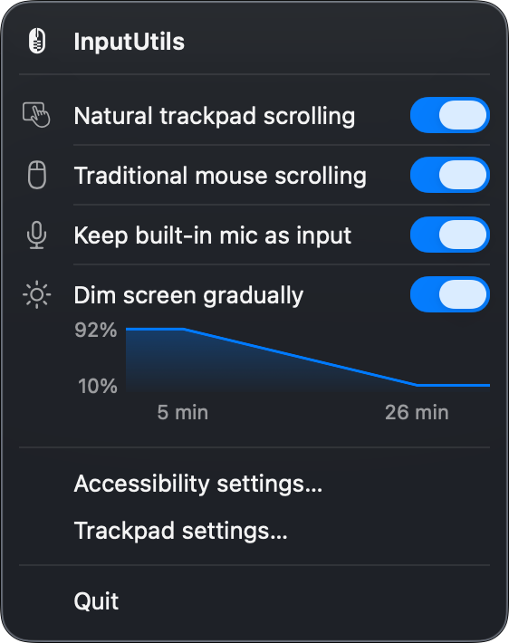
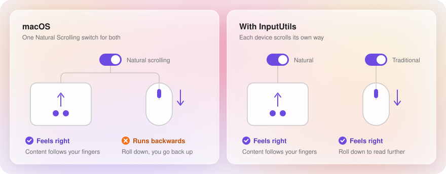
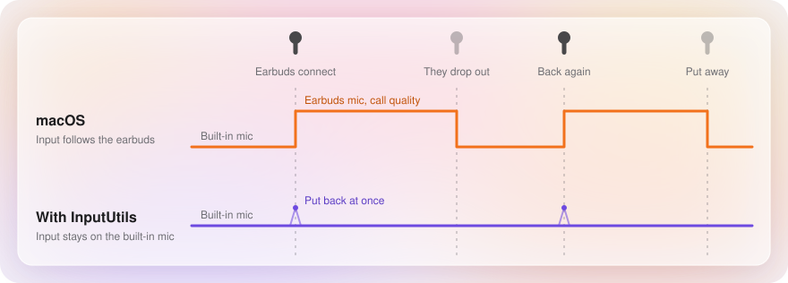
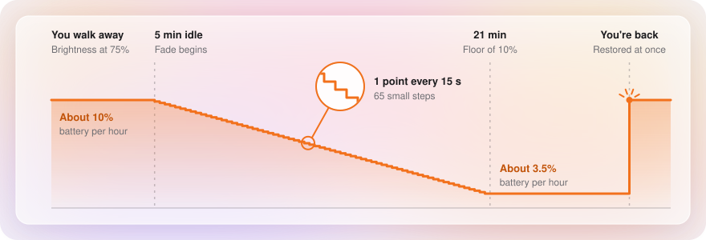

# InputUtils

A small macOS menu bar app that fixes three defaults macOS gets wrong: one scroll direction for every device, a microphone that follows whatever headset connects, and a screen that stays bright after you walk away.



## Natural trackpad, traditional mouse



macOS has a single Natural Scrolling switch for the trackpad and the mouse together. Natural is right on a trackpad, where the content follows your fingers, but the same setting turns a mouse wheel backwards. Use both, and the only fix macOS offers is a trip to System Settings every time you switch devices.

InputUtils keeps natural scrolling on the trackpad and flips only physical mouse-wheel events, so each device keeps its own direction and switching devices never sends you to System Settings. In the menu: `Natural trackpad scrolling` and `Traditional mouse scrolling`.

## The built-in mic stays your input



When Bluetooth earbuds connect, macOS moves your input to their microphone, and moves it again every time they drop and reconnect. Getting the built-in mic back means another trip to System Settings, and it is worth getting back: it sounds far better, and while the earbuds' mic is in use their playback drops to call quality.

InputUtils puts the input back on the built-in mic whenever something changes it. In the menu: `Keep built-in mic as input`.

## The screen fades when you walk away



Auto-brightness answers a different question: it sets brightness from the light in the room, and often gets even that wrong. Walking away from your desk does not make the room any darker, so a screen you forgot about keeps burning battery.

After 5 minutes with no keyboard, mouse, or trackpad input, InputUtils lowers the brightness one point on the slider every 15 seconds, down to 10%. Your next input restores your level at once. The fade waits while a video plays and stops if you change the brightness yourself. The menu draws the fade's schedule from your current brightness. In the menu: `Dim screen gradually`.

### What brightness costs

The brightness slider is not linear: its bottom 15% leaves the backlight off, and power follows the backlight, not the slider. Approximate figures measured on a 15-inch MacBook Air (M5) from macOS's own power log:

| Slider | Backlight | Screen power | Battery per hour |
| --- | --- | --- | --- |
| 10% (fade floor) | 0% | ~0 W | ~0% |
| 25% | 2% | ~0.2 W | ~0.3% |
| 50% | 27% | ~2 W | ~3% |
| 75% | 52% | ~4 W | ~6% |
| 100% | 100% | ~8 W | ~12% |

The rest of the Mac adds about 2.4 W when idle or lightly used, roughly 3.5% of the battery an hour. The bottom quarter of the slider is close to free, and past half the screen becomes the biggest draw: an idle Mac left at 75% loses about 10% an hour, and faded to 10% it loses about 3.5%.

## Build and run

```bash
./script/build_and_run.sh
```

The app is menu-bar-only, stages a signed local app bundle at `dist/InputUtils.app`, then installs and launches it from `/Applications/InputUtils.app`.

InputUtils registers itself to start at login the first time it runs. If macOS requires approval, enable it in System Settings > General > Login Items.

## Verify

```bash
bash ./script/verify_scroll_events.sh
```

The probe exercises scroll classification and inversion without requiring physical input devices.

## Permissions

The app needs Accessibility permission to rewrite mouse-wheel events and to notice the key press that restores a dimmed display. If macOS does not show the prompt, open the menu bar item and choose `Accessibility settings…`, then allow `InputUtils`.

## Notes

- Trackpad and other continuous scroll events pass through unchanged, so touch mice and smooth-wheel devices that report continuous scrolling may be treated like trackpads.
- The mouse switch always gives the mouse the direction the trackpad is not using: it reads `Traditional mouse scrolling` while natural trackpad scrolling is on, and `Natural mouse scrolling` while it is off. Turn it off to let every scroll event pass through untouched.
- Brightness goes through the private DisplayServices framework, so a macOS update could disable idle dimming; the `Dim screen gradually` row then shows `Unavailable`.
