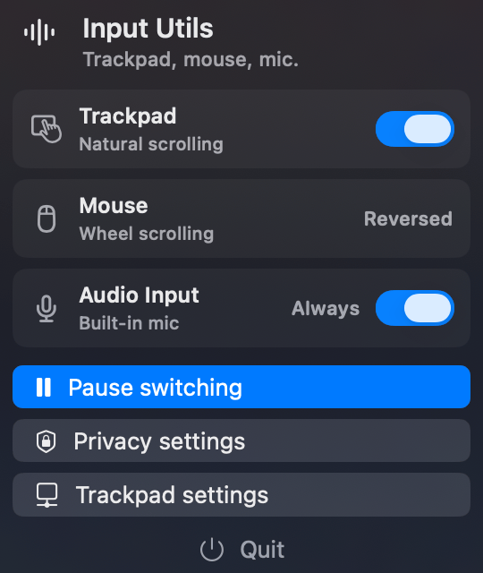

# InputUtils

InputUtils is a tiny macOS menu bar utility for trackpad, mouse, and audio input behavior.



macOS exposes Natural Scrolling as a global preference, not a clean per-device setting. This app lets you toggle that trackpad setting while using a system scroll event tap to reverse physical mouse wheel events.

It can also keep the default audio input pinned to the built-in microphone, which avoids apps switching the input to headset microphones.

## Build And Run

```bash
./script/build_and_run.sh
```

The app is menu-bar-only, stages a signed local app bundle at `dist/InputUtils.app`, then installs and launches it from `/Applications/InputUtils.app`.

InputUtils registers itself to start at login the first time it runs. If macOS requires approval, enable it in System Settings > General > Login Items.

## Verify

```bash
bash ./script/verify_scroll_events.sh
```

The probe exercises scroll classification and inversion without requiring physical input devices.

## Permissions

The app needs Accessibility permission because it modifies scroll events. If macOS does not show the prompt, open the menu bar item and choose `Open Privacy Settings`, then allow `InputUtils`.

## Notes

- Trackpad and other continuous scroll events pass through unchanged.
- Physical wheel mouse events are inverted.
- Audio input pinning restores the built-in microphone when the default input device changes.
- Smooth-wheel devices or touch mice that report continuous scroll events may be treated like trackpads by macOS.
- The menu includes `Pause switching` if you want all scroll events to pass through normally.
